# CHƯƠNG 3: CÀI ĐẶT THỬ NGHIỆM

Chương này trình bày phân tích quy trình as-is/to-be, thiết kế cơ sở dữ liệu và UML, cài đặt prototype **Oxeyns Kho & SX**, cùng kết quả kiểm thử trên môi trường **SQLite** (`backend/oxeyns.db`).

---

## 3.1. Phân tích quy trình nghiệp vụ as-is và to-be

### 3.1.1. Mô hình as-is (hiện trạng)

Tại Oxeyns Long An, luồng nghiệp vụ kho – sản xuất – Lab **đủ bước theo HACCP** nhưng **dữ liệu phân tán**:

```text
[NCC] → Thủ kho (BM-01/GMP01, Excel tồn)
      → Lab (C14 — file/email)
      → Kỹ thuật (BM-01/GMP03 giấy, tách GC)
      → Lab (GC, % t-CA — BM-02/GMP05)
      → Thủ kho (xuất giấy, cập nhật Excel)
      → ATTP (ghép hồ sơ khi thẩm tra 14 ngày)
```

**Bảng 3.1 — Đặc điểm as-is**

| Khía cạnh | Hiện trạng | Hệ quả |
|-----------|------------|--------|
| Mã lô | Mỗi bộ phận ghi riêng | Khó đối chiếu NVL ↔ mẻ ↔ TP |
| CCP | Đối chiếu tay giấy/Excel | Phát hiện fail chậm |
| Tồn kho | Cập nhật sau khi ghi sổ | Lệch số liệu |
| Truy xuất | Mở nhiều file, đối ngày | ~30–60 phút/lần (ước tính khảo sát) |
| Audit trail | Chữ ký giấy | Khó truy vết sửa Excel |

### 3.1.2. Mô hình to-be (đề xuất đã cài đặt)

Prototype web tập trung dữ liệu theo **`stock_batches`** (lô) và **`production_orders`** (mẻ):

```text
[NCC] → POST /stock/receipts → stock_batch + movement IN + CCP1
      → POST /lab/tests (C14) → ccp1_status
      → POST /production/orders → duyệt → start → xuất NVL
      → POST /production/orders/{id}/operations → CCP2 (Ttop)
      → POST /lab/tests (% t-CA) → ccp2_status
      → POST /production/orders/{id}/complete → lô TP
      → GET /reports/trace, /haccp-monitor, /audit → export PDF/CSV
```

**Bảng 3.2 — So sánh as-is / to-be**

| Khía cạnh | As-is | To-be (prototype) |
|-----------|-------|-------------------|
| Tồn kho | Excel | Cập nhật khi nhập/xuất (`stock_movements`) |
| Liên kết xuất–mẻ | Thủ công | `production_material_usages` + `production_order_id` |
| CCP | Ghi tay | `ccp.py` — pending/pass/fail; chặn complete khi fail |
| Truy xuất | Ghép file | `GET /reports/trace/{batch_no}` |
| Thẩm tra 14 ngày | Giấy | Màn Giám sát CCP + PDF DejaVu |
| Audit | Chữ ký | `audit_logs` + màn Nhật ký thao tác |

*[Hình 3.H — Sơ đồ as-is / to-be]*

```mermaid
flowchart TB
    subgraph ASIS["As-is (giấy + Excel)"]
        A1[NCC] --> A2[Thủ kho BM-01/GMP01]
        A2 --> A3[Excel tồn]
        A2 --> A4[Lab C14 file/email]
        A4 --> A5[Kỹ thuật GMP03 giấy]
        A5 --> A6[Lab GC % t-CA]
        A6 --> A7[Thủ kho xuất giấy]
        A7 --> A8[ATTP ghép hồ sơ 14 ngày]
    end
    subgraph TOBE["To-be (prototype web)"]
        B1[NCC] --> B2[POST /stock/receipts]
        B2 --> B3[CCP1 trên stock_batch]
        B3 --> B4[POST /lab/tests]
        B4 --> B5[POST /production/orders]
        B5 --> B6[start + xuất NVL]
        B6 --> B7[operations CCP2]
        B7 --> B8[complete → lô TP]
        B8 --> B9[trace / monitor / audit PDF]
    end
```

Nguồn chỉnh sửa: `docs/bao-cao/diagrams/hinh-3-h-as-is-to-be.mmd`, Phụ lục H.

---

## 3.2. Thiết kế dữ liệu

### 3.2.1. Sơ đồ ERD tổng thể

CSDL gồm **14 bảng**, quan hệ xoay quanh lô hàng và mẻ sản xuất. ORM: **SQLAlchemy 2** (`backend/app/models.py`). Lưu trữ thực tế: file **SQLite** `backend/oxeyns.db`.

Sơ đồ quan hệ (Mermaid — xem file `docs/bao-cao/erd.mmd`, sinh PNG bằng `python scripts/generate_erd.py`):

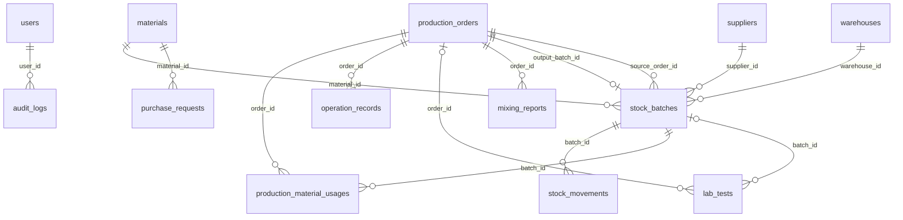

> `corrective_actions` dùng `entity_type` + `entity_id` (đa hình, không FK cứng). Các bảng còn lại tham chiếu `users` qua `created_by_id` / `approved_by_id`.

**Quy tắc mã hóa:**

| Loại | Mẫu | Ví dụ |
|------|-----|-------|
| Lô NVL | `NVL-YYYYMMDD-###` | NVL-20260620-001 |
| Phiếu nhập | `PN-YYYYMMDD-###` | PN-20260620-001 |
| Mẻ SX | `SX-YYYYMMDD-###` | SX-20260620-001 |
| Lô TP | `TP-YYYYMMDD-###` | TP-20260620-001 |

*[Hình 3.1 — Sơ đồ ERD đầy đủ — `docs/bao-cao/erd.mmd`, Phụ lục C]*

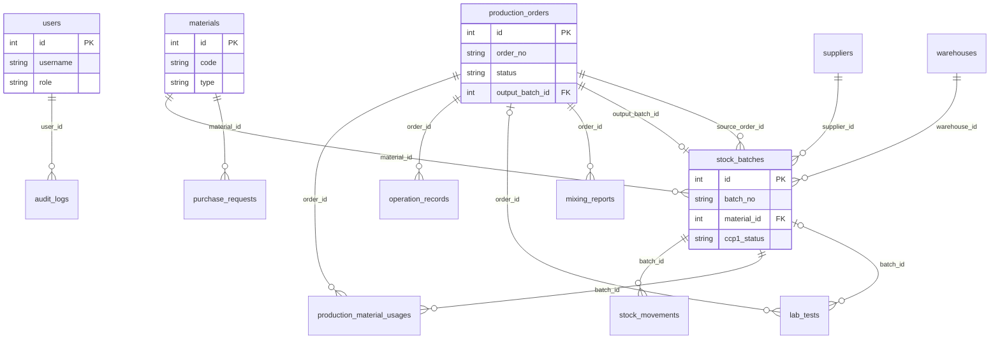

#### 3.2.1.1. Bảng users (6 vai trò)

| Cột | Kiểu | Mô tả |
|-----|------|-------|
| id | PK | Khóa chính |
| username | String(50), unique | Đăng nhập |
| password_hash | String(255) | bcrypt |
| full_name | String(100) | Hiển thị UI |
| role | Enum UserRole | admin, thu_kho, ky_thuat, lab, ql_nm, attp |
| is_active | Boolean | Khóa tài khoản |
| created_at | DateTime | Thời gian tạo |

**Tài khoản demo** (seed khi khởi động backend): `admin/admin123`, `thu_kho/kho123`, `ky_thuat/kt123`, `ql_nm/ql123`, `lab/lab123`, `attp/attp123`.

#### 3.2.1.2. Bảng materials, suppliers, warehouses

**materials**

| Cột | Kiểu | Mô tả |
|-----|------|-------|
| id | PK | Khóa chính |
| code | String(50), unique | Mã NVL/BTP/TP |
| name | String(200) | Tên vật tư |
| type | Enum MaterialType | NVL, BTP, TP |
| unit | String(20) | kg, L… |
| min_stock | Numeric(12,3) | Ngưỡng cảnh báo Dashboard |
| is_active | Boolean | Ẩn/hiện danh mục |

**suppliers**

| Cột | Kiểu | Mô tả |
|-----|------|-------|
| id | PK | |
| code | String(50), unique | Mã NCC |
| name | String(200) | Tên NCC (dầu quế) |
| contact | String(200), nullable | Liên hệ |
| is_active | Boolean | |

**warehouses**

| Cột | Kiểu | Mô tả |
|-----|------|-------|
| id | PK | |
| code | String(50), unique | Mã kho |
| name | String(100) | Kho NVL, kho TP |
| is_active | Boolean | |

#### 3.2.1.3. Bảng stock_batches (lô hàng, CCP1)

Trung tâm truy xuất.

| Cột | Kiểu | Mô tả |
|-----|------|-------|
| id | PK | |
| batch_no | String(50), unique | NVL-/TP-YYYYMMDD-### |
| material_id | FK → materials | Loại hàng |
| supplier_id | FK → suppliers, nullable | NCC (NVL) |
| warehouse_id | FK → warehouses | Vị trí lưu |
| quantity | Numeric(12,3) | Tồn hiện tại |
| ccp1_c14 | Numeric(10,4), nullable | Giá trị C14 |
| ccp1_status | Enum CCPStatus | pending/pass/fail |
| source_order_id | FK → production_orders, nullable | Mẻ sinh ra lô TP |
| receipt_note | Text, nullable | Ghi chú nhập |
| created_at | DateTime | |

#### 3.2.1.4. Bảng stock_movements (phiếu nhập PN / xuất PX)

| Cột | Kiểu | Mô tả |
|-----|------|-------|
| id | PK | |
| movement_type | Enum | IN / OUT |
| batch_id | FK → stock_batches | Lô liên quan |
| quantity | Numeric(12,3) | Số lượng biến động |
| reference_no | String(50) | Mã PN hoặc PX |
| production_order_id | FK, nullable | Mẻ SX (khi xuất cho sản xuất) |
| notes | Text, nullable | Ghi chú |
| created_by_id | FK → users | |
| created_at | DateTime | Audit |

API: `POST /stock/receipts`, `POST /stock/issues`, `GET /stock/movements`.

#### 3.2.1.5. Bảng production_orders (mẻ sản xuất)

| Cột | Kiểu | Mô tả |
|-----|------|-------|
| id | PK | |
| order_no | String(50), unique | SX-YYYYMMDD-### |
| product_material_id | FK → materials | TP đích (t-CA) |
| planned_qty | Numeric(12,3) | Kế hoạch |
| actual_qty | Numeric(12,3), nullable | Thực tế sau complete |
| status | Enum OrderStatus | draft/approved/running/done/cancelled |
| order_type | Enum | normal / redistill |
| output_batch_id | FK → stock_batches, nullable | Lô TP sau complete |
| approved_by_id | FK → users, nullable | QL NM duyệt |
| approved_at | DateTime, nullable | |
| created_by_id | FK → users | |
| created_at | DateTime | |
| started_at | DateTime, nullable | |
| finished_at | DateTime, nullable | |

#### 3.2.1.6. Bảng production_material_usages

| Cột | Kiểu | Mô tả |
|-----|------|-------|
| id | PK | |
| order_id | FK → production_orders | Mẻ SX |
| batch_id | FK → stock_batches | Lô NVL đã dùng |
| quantity | Numeric(12,3) | Khối lượng xuất |
| movement_id | FK → stock_movements, nullable | Liên kết phiếu xuất |

Nền tảng truy xuất và báo cáo cân đối NVL (`GET /production/orders/{id}/balance`).

#### 3.2.1.7. Bảng operation_records (CCP2)

| Cột | Kiểu | Mô tả |
|-----|------|-------|
| id | PK | |
| order_id | FK → production_orders | Mẻ SX |
| step | String(50) | Công đoạn (chưng cất…) |
| temperature | Numeric(8,2), nullable | Nhiệt độ |
| pressure | Numeric(8,3), nullable | Áp suất |
| t_top | Numeric(8,2), nullable | Ttop — CCP2 |
| t_ca_percent | Numeric(8,3), nullable | % t-CA |
| ccp2_status | Enum CCPStatus | pending/pass/fail |
| notes | Text, nullable | |
| created_by_id | FK → users | |
| created_at | DateTime | |

API: `POST /production/orders/{id}/operations`. Rule: `ccp.py` — Ttop 107–110°C; % t-CA > 99%.

#### 3.2.1.8. Bảng lab_tests

| Cột | Kiểu | Mô tả |
|-----|------|-------|
| id | PK | |
| order_id | FK, nullable | CCP2 theo mẻ |
| batch_id | FK, nullable | CCP1 theo lô |
| test_type | String(30) | C14, TCA, GC… |
| gc_data | Text, nullable | Dữ liệu GC |
| c14 | Numeric(10,4), nullable | C14 dpm/gC |
| t_ca_percent | Numeric(8,3), nullable | Hàm lượng t-CA |
| result_status | Enum CCPStatus | Kết quả tổng hợp |
| created_by_id | FK → users | |
| created_at | DateTime | |

API: `POST /lab/tests`. Gắn `batch_id` (CCP1) hoặc `order_id` (CCP2).

#### 3.2.1.9. Bảng purchase_requests (YCMH)

| Cột | Kiểu | Mô tả |
|-----|------|-------|
| id | PK | |
| material_id | FK → materials | NVL cần mua |
| requested_qty | Numeric(12,3) | Số lượng đề xuất |
| reason | String(200), nullable | Lý do |
| status | Enum | pending/approved/ordered/cancelled |
| created_by_id | FK → users | |
| created_at | DateTime | |

API: `POST /stock/purchase-requests`.

#### 3.2.1.10. Bảng audit_logs

| Cột | Kiểu | Mô tả |
|-----|------|-------|
| id | PK | |
| user_id | FK → users, nullable | Người thao tác |
| action | String(50) | login, receipt, approve… |
| entity | String(50) | Loại đối tượng |
| entity_id | String(50), nullable | ID tham chiếu |
| detail | Text, nullable | JSON mô tả |
| created_at | DateTime | |

Không cho sửa/xóa qua UI — phục vụ ATTP. Hiển thị tiếng Việt qua `audit_display.py`.

#### 3.2.1.11. Bảng mixing_reports (BM-01/GMP05)

| Cột | Kiểu | Mô tả |
|-----|------|-------|
| id | PK | |
| order_id | FK → production_orders | Mẻ liên quan |
| formula | String(200), nullable | Công thức pha |
| input_batches | Text, nullable | JSON danh sách lô đầu vào |
| mixed_qty | Numeric(12,3) | Khối lượng pha |
| notes | Text, nullable | |
| created_by_id | FK → users | |
| created_at | DateTime | |

API: `POST /production/mixing-reports`, export `GET /reports/mixing/{order_id}/pdf`. **UI đầy đủ ngoài phạm vi MVP.**

#### 3.2.1.12. Bảng corrective_actions

| Cột | Kiểu | Mô tả |
|-----|------|-------|
| id | PK | |
| entity_type | String(50) | stock_batch, production_order… |
| entity_id | int | ID đối tượng (polymorphic) |
| reason | Text | Lý do không đạt |
| action_taken | Text, nullable | Biện pháp khắc phục |
| status | String(30) | open/closed… |
| created_by_id | FK → users | |
| created_at | DateTime | |

API: `POST /quality/corrective-actions`. Dùng khi CCP fail; không có FK cứng tới bảng nghiệp vụ.

---

### 3.2.2. Sơ đồ UML

#### 3.2.2.1. Use case tổng quát (11 menu, 6 vai trò)

**Tác nhân:** Admin, Thủ kho, Kỹ thuật, Lab, QL NM, ATTP.

**11 use case (menu):** Bảng tổng quan; Tồn kho; Nhập kho; Xuất kho; Sản xuất; Kiểm nghiệm; Truy xuất lô; Yêu cầu mua hàng; Giám sát CCP; Nhật ký thao tác; Báo cáo và xuất file.

**Bảng 3.3 — Phân quyền use case (tóm tắt)**

| Menu | thu_kho | ky_thuat | lab | ql_nm | attp | admin |
|------|---------|----------|-----|-------|------|-------|
| Nhập/Xuất/Tồn | ✓ | | | ✓ | ✓ | ✓ |
| Sản xuất | | ✓ | | ✓ | ✓ | ✓ |
| Kiểm nghiệm | | | ✓ | ✓ | ✓ | ✓ |
| Giám sát CCP, Audit | | | | ✓ | ✓ | ✓ |
| YCMH | ✓ | | | ✓ | | ✓ |

*[Hình 3.2 — Use case tổng quát]*

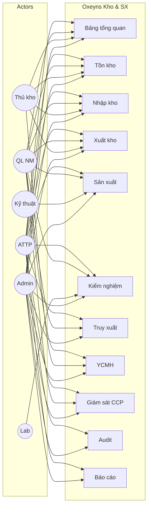

#### 3.2.2.2. Use case phân rã theo module

| Module | Use case chi tiết | API chính |
|--------|-------------------|-----------|
| Kho | Nhập/xuất; tồn; YCMH; danh mục NVL | `/stock/*`, `/materials` |
| SX | Tạo/duyệt/bắt đầu/hủy mẻ; operation; complete | `/production/orders/*` |
| Lab | Nhập C14, % t-CA, GC | `/lab/tests` |
| ATTP | Trace; monitor CCP; audit; export | `/reports/*`, `/quality/*` |

*[Hình 3.2b — Use case phân rã]*

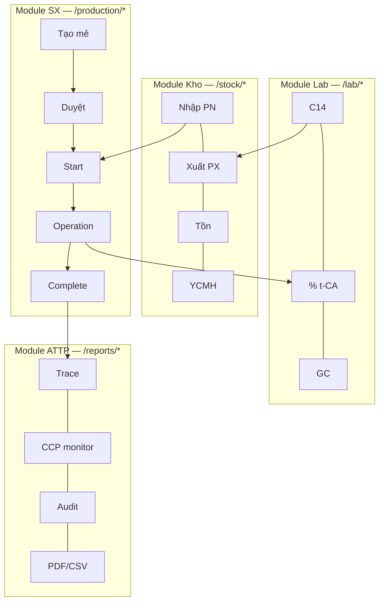

---

### 3.2.3. Sơ đồ tuần tự các luồng chính

Mô tả **14 luồng** — sơ đồ tuần tự UML (Hình 3.3–3.16). Ký hiệu: **User** → **Frontend (React)** → **API (FastAPI)** → **SQLite**. Nguồn: `docs/bao-cao/diagrams/sequences.mmd`.

#### 3.2.3.1. Đăng nhập và phân quyền

1. User nhập username/password trên `Login.tsx`.
2. `POST /api/v1/auth/login` → verify bcrypt → JWT.
3. Lưu token `localStorage`; route guard trong `App.tsx`.
4. Request sau gửi `Authorization: Bearer …`; `require_roles` → 403 nếu thiếu quyền.

*[Hình 3.3]*

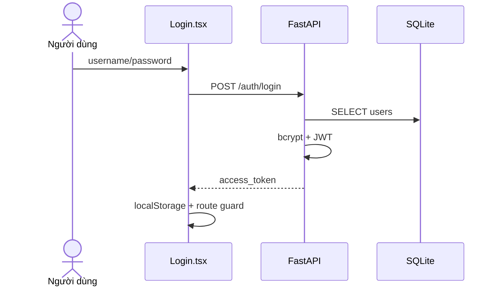

#### 3.2.3.2. Nhập kho nguyên liệu và đánh giá CCP1

1. Thủ kho điền form Nhập kho: vật tư, NCC, số lượng, mã lô NCC.
2. `POST /stock/receipts` → tạo `stock_batch`, movement IN, sinh `reference_no` PN.
3. Lab nhập C14 qua Kiểm nghiệm hoặc kèm nhập kho → `evaluate_ccp1` → `ccp1_status`.
4. Fail → không cho xuất SX; ghi corrective action nếu cần.

*[Hình 3.4]*

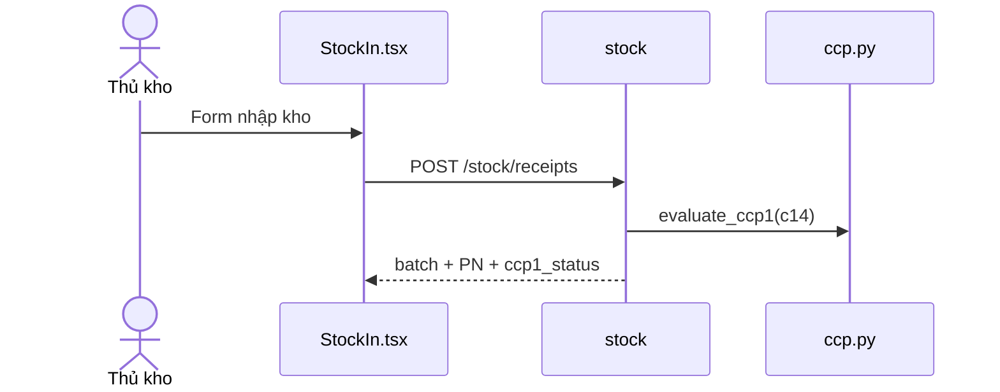

#### 3.2.3.3. Xuất kho nguyên liệu

1. Chọn lô, số lượng trên màn Xuất kho.
2. Server kiểm tra `quantity` đủ; `ccp1_status` = pass.
3. `POST /stock/issues` → movement OUT, giảm tồn; ghi audit.

*[Hình 3.5]*

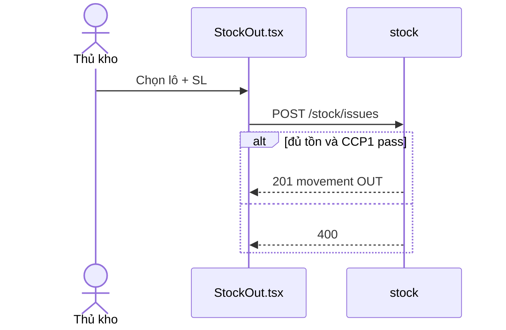

#### 3.2.3.4. Tạo yêu cầu mua hàng

1. Dashboard cảnh báo `quantity < min_stock`.
2. `POST /stock/purchase-requests` → trạng thái pending.
3. QL NM xem danh sách (duyệt nhiều cấp: giai đoạn sau).

*[Hình 3.6]*

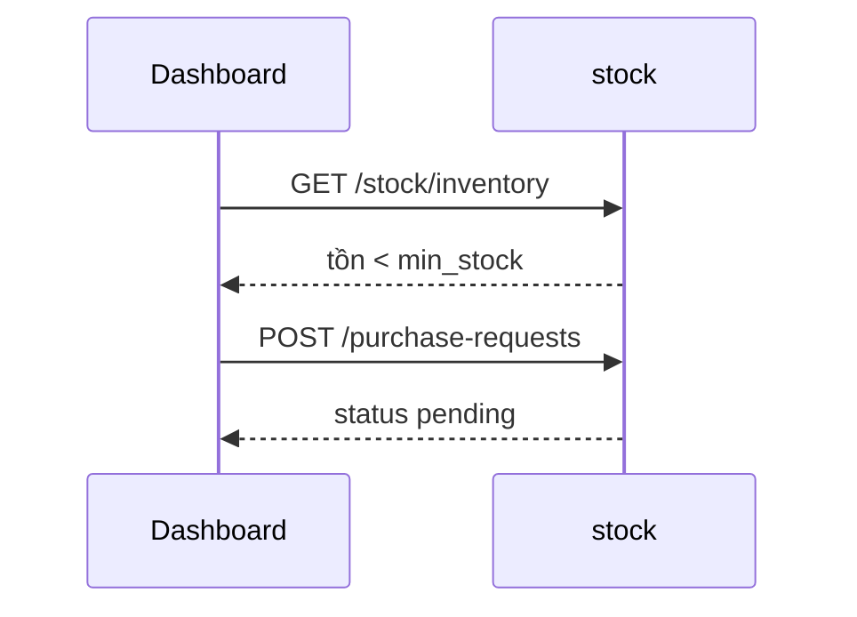

#### 3.2.3.5. Tạo và duyệt mẻ sản xuất

1. `POST /production/orders` → status `draft`.
2. QL NM: `POST /production/orders/{id}/approve` → `approved`.

*[Hình 3.7]*

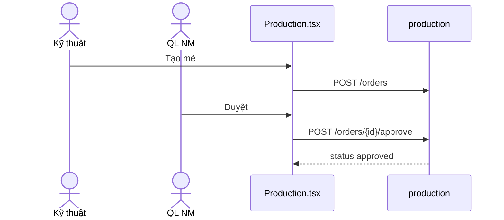

#### 3.2.3.6. Bắt đầu sản xuất — phân bổ và xuất NVL

1. `POST /production/orders/{id}/start` → `running`.
2. Tạo `production_material_usages` + issue movement OUT gắn `production_order_id`.
3. Chỉ lô CCP1 pass được chọn.

*[Hình 3.8]*

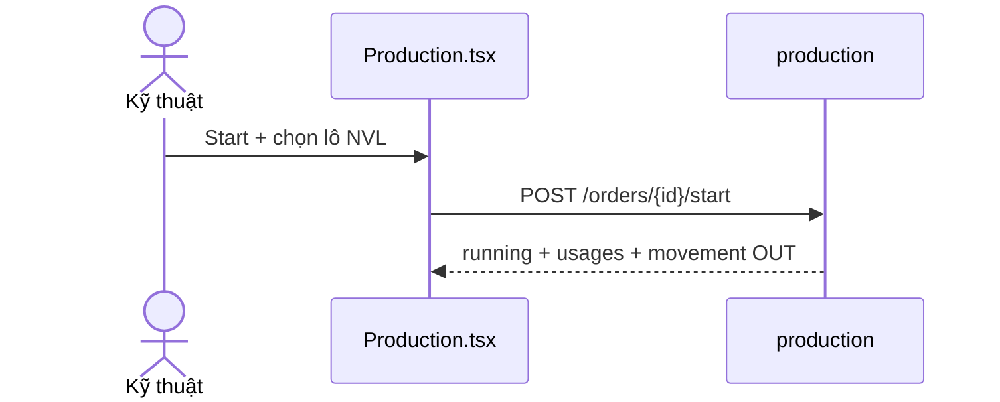

#### 3.2.3.7. Ghi điểm kiểm soát 2 (operation record)

1. Kỹ thuật nhập Ttop, nhiệt độ, áp suất.
2. `POST /production/orders/{id}/operations` → `evaluate_ccp2` (partial nếu thiếu % t-CA).

*[Hình 3.9]*

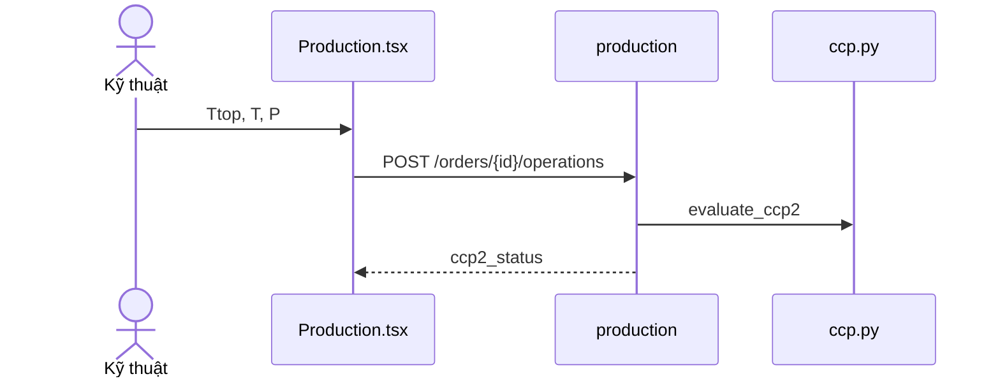

#### 3.2.3.8. Hoàn thành mẻ — tạo lô thành phẩm

1. `POST /production/orders/{id}/complete` — chỉ khi CCP2 pass.
2. Tạo `stock_batch` TP, gán `output_batch_id`; status → `done`.

*[Hình 3.10]*

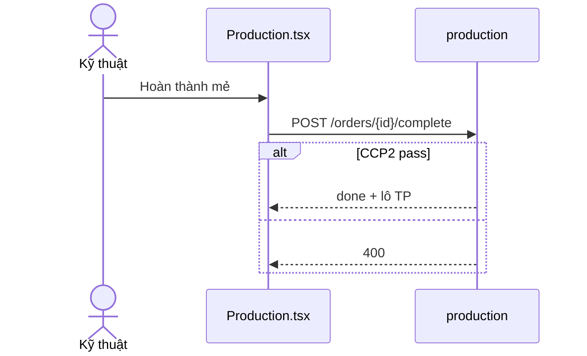

#### 3.2.3.9. Kiểm nghiệm Lab

1. `POST /lab/tests` với `batch_id` hoặc `order_id`.
2. Cập nhật CCP1/CCP2; hiển thị pass/fail trên UI.

*[Hình 3.11]*

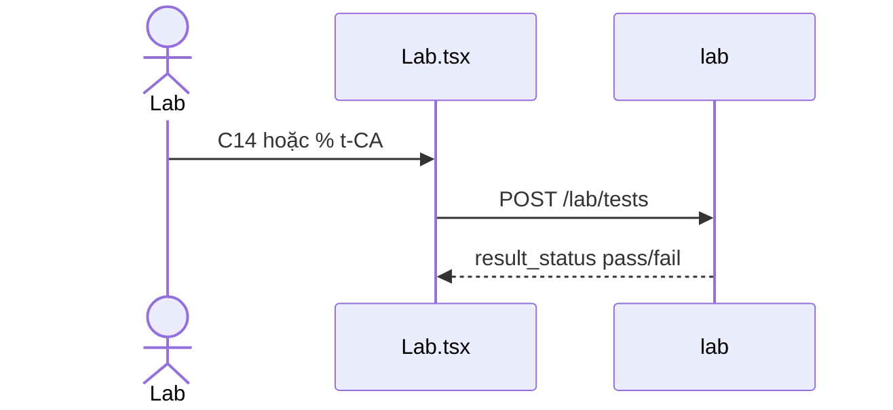

#### 3.2.3.10. Truy xuất nguồn gốc lô (2 chiều)

1. `GET /reports/trace-suggestions?q=…` — gợi ý mã lô.
2. `GET /reports/trace/{batch_no}` — cây NVL ↔ mẻ ↔ TP (gồm lô TP hiện tại).

*[Hình 3.12]*

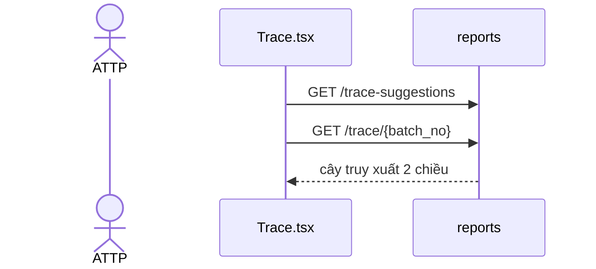

#### 3.2.3.11. Giám sát CCP 14 ngày và xuất PDF

1. `GET /reports/haccp-monitor?from=&to=` — lọc 14 ngày mặc định.
2. `GET /reports/haccp-monitor/export` — PDF biên bản tiếng Việt.

*[Hình 3.13]*

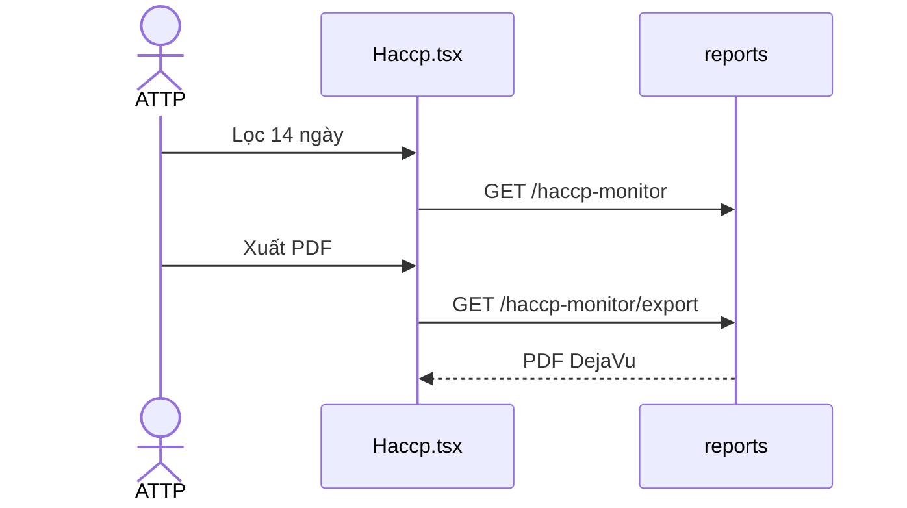

#### 3.2.3.12. Nhật ký thao tác và xuất PDF/CSV

1. `GET /reports/audit` — lọc ngày, enrichment tiếng Việt (`audit_display.py`).
2. Export PDF/CSV UTF-8 BOM.

*[Hình 3.14]*

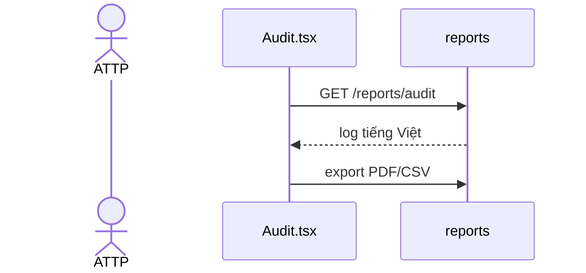

#### 3.2.3.13. Hành động khắc phục khi không đạt CCP

1. Rule chặn issue/complete khi fail.
2. `POST /quality/corrective-actions` — ghi lý do, biện pháp.

*[Hình 3.15]*

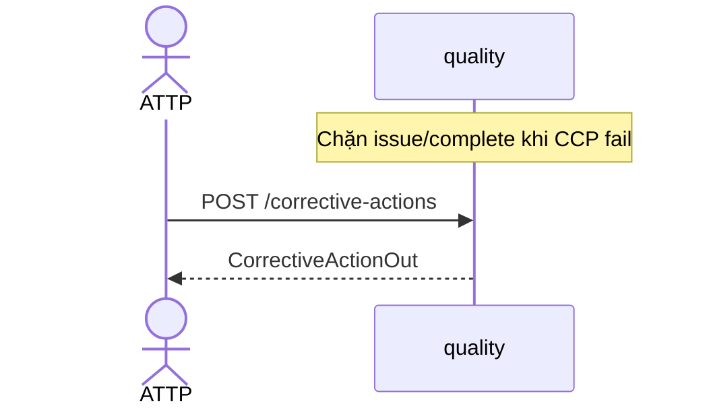

#### 3.2.3.14. Hủy mẻ sản xuất

1. `POST /production/orders/{id}/cancel` — từ `draft`/`approved`/`running`.
2. Status → `cancelled`; không tạo lô TP.

*[Hình 3.16]*

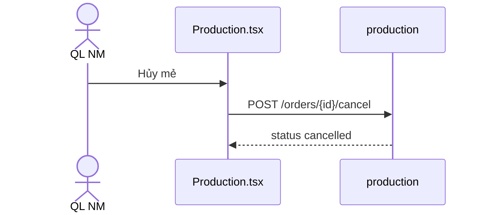

---

### 3.2.4. Sơ đồ trạng thái mẻ sản xuất

```text
[draft] --approve--> [approved]
[approved] --start--> [running]
[running] --complete (CCP2 pass)--> [done]
[draft | approved | running] --cancel--> [cancelled]
```

Enum thực tế trong `models.py`: `OrderStatus`. Hoàn thành mẻ yêu cầu CCP2 pass — API trả 400 nếu fail.

*[Hình 3.17 — State machine mẻ sản xuất]*

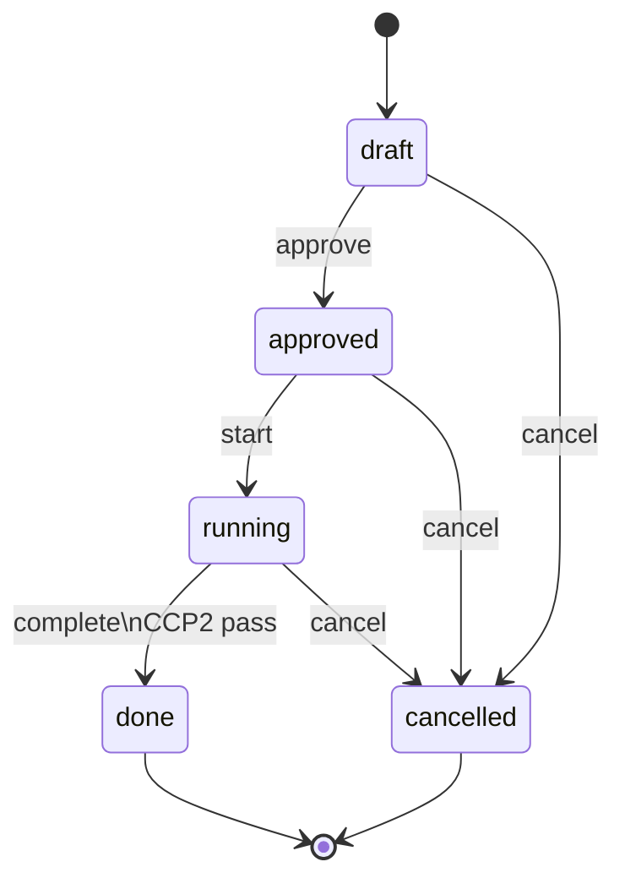

### 3.2.5. Sơ đồ luồng dữ liệu Kho – SX – Lab – ATTP

```mermaid
flowchart TB
    K[Kho\nstock_batches\nstock_movements] --> S[SX\nproduction_orders\nusages/operations]
    S --> L[Lab\nlab_tests]
    L --> S
    K --> L
    K --> A[ATTP\naudit_logs\ntrace/CCP/PDF]
    S --> A
    L --> A
```

Dữ liệu **không sửa lịch sử** — điều chỉnh qua movement/audit mới.

### 3.2.6. Ánh xạ biểu mẫu BM-xx/GMPxx ↔ chức năng phần mềm

| Biểu mẫu | Màn hình / API | Export |
|----------|----------------|--------|
| BM-01/GMP01 | Nhập kho, `/stock/receipts` | `/reports/receipt/{id}/pdf` |
| BM-02/GMP01 | Dashboard, Tồn kho | `/reports/inventory/export` (CSV/PDF) |
| BM-01/GMP03 | Sản xuất, operations | `/reports/operation/{id}/pdf` |
| BM-01/GMP04 | Mẻ SX | — |
| BM-02/GMP05 | Kiểm nghiệm | `/reports/lab/{id}/pdf` |
| BM-01/GMP05 | mixing_reports (API) | `/reports/mixing/{id}/pdf` |
| Thẩm tra CCP | Giám sát CCP | `/reports/haccp-monitor/export` |

---

## 3.3. Thiết kế và cài đặt hệ thống

### 3.3.1. Kiến trúc 3 tầng (React — FastAPI — SQLite)

*[Hình 3.18 — Kiến trúc 3 tầng]*

```mermaid
flowchart TB
    subgraph Presentation["React 19 + Vite :5173"]
        P1[12 trang tiếng Việt]
        P2[api.ts JWT]
    end
    subgraph Application["FastAPI :8000"]
        A1[routers RBAC]
        A2[ccp audit pdf_export]
    end
    subgraph Data["SQLite oxeyns.db"]
        D1[14 bảng]
    end
    P2 -->|REST /api/v1| A1
    A1 --> A2
    A1 --> D1
```

> **CSDL:** Chỉ **SQLite** được cài đặt và kiểm thử. `docker-compose.yml` (PostgreSQL 16) có trong repo nhưng **chưa chạy, chưa kết nối** — xem Chương 4.

**Cấu trúc mã nguồn:**
|---------|----------|
| `frontend/src/pages/` | 12 trang: Dashboard, Inventory, StockIn, StockOut, Production, Lab, Trace, PurchaseRequests, Haccp, Audit, Reports, Login |
| `frontend/src/api.ts` | Wrapper `fetch` → `/api/v1` |
| `frontend/src/auth.ts` | JWT localStorage |
| `backend/app/routers/` | auth, stock, production, lab, reports, quality, materials |
| `backend/app/services/` | `ccp.py`, `audit.py`, `audit_display.py` |
| `backend/app/` | `pdf_export.py`, `pdf_fonts.py`, `csv_export.py`, `seed.py`, `migrate.py` |

### 3.3.2. Mô tả API REST và phân quyền RBAC

Tất cả API (trừ login) yêu cầu JWT. Prefix: **`/api/v1`**.

**Bảng 3.4 — Endpoint tiêu biểu**

| Method | Path | Mô tả | Vai trò |
|--------|------|-------|---------|
| POST | /auth/login | Đăng nhập | Public |
| GET | /auth/me | Thông tin user | Đã đăng nhập |
| GET | /stock/batches | Danh sách lô | Kho, QL, ATTP |
| POST | /stock/receipts | Nhập kho | thu_kho |
| POST | /stock/issues | Xuất kho | thu_kho |
| GET | /stock/inventory | Tồn kho | Nhiều role |
| POST | /production/orders | Tạo mẻ | ky_thuat, ql_nm |
| POST | /production/orders/{id}/approve | Duyệt | ql_nm |
| POST | /production/orders/{id}/complete | Hoàn thành | ky_thuat, ql_nm |
| POST | /lab/tests | Kiểm nghiệm | lab |
| GET | /reports/trace/{batch_no} | Truy xuất | attp, ql_nm |
| GET | /reports/haccp-monitor | Giám sát CCP | attp |
| GET | /reports/audit | Nhật ký | attp, admin |
| POST | /quality/corrective-actions | Khắc phục CCP | attp, ql_nm |

Đặc tả đầy đủ: **Phụ lục B** (`docs/api-spec.md`). Mọi thao tác ghi quan trọng đều gọi `audit.log_action(...)`.

### 3.3.3. Môi trường cài đặt

**Yêu cầu:** Python 3.11+, Node.js 18+, npm.

```powershell
# Backend
cd backend
python -m venv .venv
.\.venv\Scripts\pip install -r requirements.txt
.\.venv\Scripts\uvicorn app.main:app --reload --port 8000

# Frontend (terminal khác)
cd frontend
npm install
npm run dev
```

- Truy cập UI: `http://localhost:5173`
- Swagger API: `http://localhost:8000/docs`
- Vite proxy `/api` → port 8000 (`vite.config.ts`)

**Khởi tạo dữ liệu:** `main.py` lifespan → `Base.metadata.create_all` → `run_migrations()` (SQLite) → `seed_database()` (user, NVL mẫu).

`docker-compose.yml` và `docs/deploy.md` mô tả hướng deploy PostgreSQL — **ngoài phạm vi đã thực hiện**.

---

## 3.4. Kết quả thử nghiệm prototype

### 3.4.1. Tổng quan 11 menu giao diện

Menu trong `frontend/src/Layout.tsx`:

| STT | Menu | File trang | Chức năng |
|-----|------|------------|-----------|
| 1 | Bảng tổng quan | Dashboard.tsx | Cảnh báo tồn, mẻ, CCP |
| 2 | Tồn kho | Inventory.tsx | Danh sách lô, CCP1 |
| 3 | Nhập kho | StockIn.tsx | Phiếu nhập PN |
| 4 | Xuất kho | StockOut.tsx | Phiếu xuất PX |
| 5 | Sản xuất | Production.tsx | Mẻ, operation, complete |
| 6 | Kiểm nghiệm | Lab.tsx | C14, % t-CA |
| 7 | Truy xuất lô | Trace.tsx | Trace + gợi ý mã |
| 8 | Yêu cầu mua hàng | PurchaseRequests.tsx | YCMH |
| 9 | Giám sát CCP | Haccp.tsx | Monitor 14 ngày |
| 10 | Nhật ký thao tác | Audit.tsx | Audit log |
| 11 | Báo cáo và xuất file | Reports.tsx | PDF/CSV |

Giao diện **tiếng Việt**; sidebar; form validation cơ bản.

### 3.4.2. Bảng tổng quan và Tồn kho

**Dashboard** gọi API tồn, mẻ `running`, CCP fail gần đây (`/reports/ccp-summary`). **Tồn kho** liệt kê `batch_no`, vật tư, `quantity`, `ccp1_status`, kho — sort/filter theo mã lô.

### 3.4.3. Nhập kho / Xuất kho / Yêu cầu mua hàng

- **Nhập kho:** chọn NVL, NCC, kho; nhập số lượng, mã lô NCC; tùy chọn C14; tự sinh PN và `batch_no`.
- **Xuất kho:** chọn lô pass CCP1; kiểm tra tồn; có thể gắn mẻ SX.
- **YCMH:** tạo khi tồn thấp hoặc thủ công; danh sách trạng thái pending.

### 3.4.4. Sản xuất: tạo mẻ, duyệt, CCP2, hoàn thành TP

Luồng UI: tạo mẻ → duyệt (QL NM) → bắt đầu (xuất NVL) → thêm operation (Ttop) → Lab nhập % t-CA → **Hoàn thành** (chỉ khi CCP2 pass). Nút **Hủy mẻ** cho trạng thái phù hợp. Hiển thị trạng thái `draft/approved/running/done/cancelled` bằng nhãn tiếng Việt.

### 3.4.5. Kiểm nghiệm Lab

Form: chọn lô hoặc mẻ; loại test; nhập C14 hoặc % t-CA; ghi chú GC. Sau lưu, badge pass/fail/pending cập nhật ngay.

### 3.4.6. Truy xuất lô và gợi ý mã lô

Ô tìm kiếm + chip gợi ý từ `trace-suggestions`; kết quả hiển thị cây: lô NVL đã dùng → mẻ SX → lô TP (kể cả lô đích khi trace từ TP).

### 3.4.7. Giám sát điểm kiểm soát (CCP1/CCP2)

Bảng lọc theo khoảng ngày (mặc định 14 ngày): cột mã lô/mẻ, loại CCP, giá trị đo, trạng thái, thời gian (timezone VN). Nút xuất PDF biên bản.

### 3.4.8. Báo cáo xuất file

| Loại | Định dạng | Ghi chú |
|------|-----------|---------|
| Tồn kho | CSV, PDF | UTF-8 BOM / DejaVu |
| Phiếu nhập | PDF | `/reports/receipt/{id}/pdf` |
| Operation | PDF | |
| Cân đối NVL | PDF | theo mẻ |
| Lab / GC | PDF | |
| Biên bản CCP | PDF | haccp-monitor export |

### 3.4.9. Nhật ký thao tác hệ thống

Lọc theo khoảng ngày; hiển thị hành động tiếng Việt (Đăng nhập, Nhập kho, Duyệt mẻ…); export PDF/CSV. Chỉ role `attp` và `admin` xem đầy đủ (test `test_roles.py`).

### 3.4.10. Kiểm thử: pytest (17 case), UAT 10/10, luồng E2E

**Môi trường:** Local — SQLite + Vite; ngày UAT 20/06/2026.

**Bảng 3.5 — pytest tự động**

| File | Nội dung | Số test |
|------|----------|---------|
| test_ccp.py | Rule CCP1/CCP2 | 13 |
| test_roles.py | RBAC, chặn xuất quá tồn | 3 |
| test_e2e_api.py | Luồng NVL → TP | 1 |
| **Tổng** | | **17/17 pass** |

**Bảng 3.6 — UAT (10 kịch bản)**

| ID | Mô tả | Kết quả |
|----|--------|---------|
| TC-01 | Nhập kho NVL | PASS |
| TC-02 | Cảnh báo tồn & YCMH | PASS |
| TC-03 | CCP1 pass | PASS |
| TC-04 | Mẻ SX + xuất NVL + operation | PASS |
| TC-05 | CCP2 pass & hoàn thành mẻ | PASS |
| TC-06 | CCP fail — chặn release | PASS |
| TC-07 | Dashboard + export CSV | PASS |
| TC-08 | Truy xuất 2 chiều | PASS |
| TC-09 | Audit log ATTP | PASS |
| TC-10 | Phân quyền role | PASS |

**Luồng E2E mẫu:** nhập 500 kg dầu quế → C14 = 13,80 → mẻ SX, xuất 400 kg → Ttop = 109°C → % t-CA = 99,5% → complete → trace lô TP → audit ≥ 6 bản ghi. Thời gian UI ~25 phút; API E2E ~8 giây.

### 3.4.11. Xác nhận phần mềm FSSC 8.7 (IQ/OQ/PQ rút gọn)

Theo `docs/software-validation.md`:

| Giai đoạn | Nội dung đã làm | Bằng chứng |
|-----------|-----------------|------------|
| IQ | Cài Python, Node, pip/npm install | `requirements.txt`, `package.json` |
| OQ | Rule CCP, chặn complete, audit | pytest, test_e2e_api |
| PQ | UAT 10 kịch bản nghiệp vụ | `uat-results.md` |

**Chưa có** chữ ký ATTP — draft phục vụ báo cáo TTTN.

### 3.4.12. Giao diện tiếng Việt, phân quyền menu và bảo mật JWT

- Nhãn, nút, thông báo lỗi tiếng Việt (`401` Phiên hết hạn, `403` Không có quyền).
- Menu/route ẩn theo role trên frontend; backend kiểm tra lại bằng `require_roles`.
- JWT HS256, 480 phút; mật khẩu bcrypt; không lưu plain text.

- JWT HS256, 480 phút; mật khẩu bcrypt; không lưu plain text.

### 3.4.13. Minh họa giao diện 11 menu (Hình 3.19–3.29)

Khi nộp Word: chụp màn hình thực tế đặt tại `docs/screenshots/` (Phụ lục L). Dưới đây là wireframe ASCII khớp UI đã cài (`docs/wireframes/README.md`).

| Hình | Menu | Route | File |
|------|------|-------|------|
| 3.19 | Bảng tổng quan | `/` | Dashboard.tsx |
| 3.20 | Tồn kho | `/inventory` | Inventory.tsx |
| 3.21 | Nhập kho | `/stock-in` | StockIn.tsx |
| 3.22 | Xuất kho | `/stock-out` | StockOut.tsx |
| 3.23 | Sản xuất | `/production` | Production.tsx |
| 3.24 | Kiểm nghiệm | `/lab` | Lab.tsx |
| 3.25 | Truy xuất lô | `/trace` | Trace.tsx |
| 3.26 | Yêu cầu mua hàng | `/purchase` | PurchaseRequests.tsx |
| 3.27 | Giám sát CCP | `/haccp` | Haccp.tsx |
| 3.28 | Nhật ký thao tác | `/audit` | Audit.tsx |
| 3.29 | Báo cáo xuất file | `/reports` | Reports.tsx |

**Hình 3.19 — Dashboard** (ô KPI: tồn NVL, mẻ chạy, CCP fail, tồn thấp; danh sách cảnh báo):

```text
┌──────────┬────────────────────────────────────────┐
│ SIDEBAR  │  Bảng tổng quan                        │
│ 11 menu  │  [NVL tồn] [Mẻ chạy] [CCP fail] [Tồn thấp]│
│          │  Cảnh báo: NL-QUE < min → YCMH         │
└──────────┴────────────────────────────────────────┘
```

**Hình 3.21 — Nhập kho** (form BM-01/GMP01, CCP1 C14):

```text
┌──────────┬────────────────────────────────────────┐
│ SIDEBAR  │  Phiếu nhập NVL — NCC, NVL, SL, C14   │
│          │  [Lưu phiếu nhập] → sinh PN + batch_no │
└──────────┴────────────────────────────────────────┘
```

**Hình 3.23 — Sản xuất** (danh sách mẻ, operation Ttop, nút Hoàn thành):

```text
┌──────────┬────────────────────────────────────────┐
│ SIDEBAR  │  Mẻ SX-20260620-001 | running | CCP2  │
│          │  Ttop [109]°C  [Hoàn thành mẻ]        │
└──────────┴────────────────────────────────────────┘
```

**Lệnh chụp screenshot khi demo:**

```powershell
cd backend; .\.venv\Scripts\uvicorn app.main:app --reload --port 8000
cd frontend; npm run dev
# Mở http://localhost:5173 — đăng nhập thu_kho/kho123 hoặc attp/attp123
# Lưu ảnh: docs/screenshots/03-19-dashboard.png … 03-29-reports.png
```

---

**Bảng 3.7 — Tóm tắt kết quả thử nghiệm**

| Hạng mục | Mục tiêu | Đạt |
|----------|----------|-----|
| CSDL | SQLite, 14 bảng | ✓ |
| API REST | `/api/v1`, RBAC | ✓ |
| Menu UI | 11 | ✓ |
| CCP1 + CCP2 | Rule + UI | ✓ |
| Truy xuất 2 chiều | trace API | ✓ |
| pytest | 17/17 | ✓ |
| UAT | 10/10 | ✓ |
| PDF tiếng Việt | ReportLab + DejaVu | ✓ |
| Validation draft | software-validation.md | ✓ (draft) |
| PostgreSQL Docker | — | Chưa (ngoài phạm vi) |

---

Chương 3 đã mô tả đầy đủ quá trình từ phân tích nghiệp vụ đến cài đặt và kiểm thử prototype. Chương 4 tổng kết kết quả, hạn chế và hướng phát triển.

## 3.12. Cập nhật cài đặt và kiểm chứng Digital QMS

Sau baseline, hệ thống đã bổ sung API và UI cho M1–M6, Alembic/model Digital QMS, release certificate, CAPA, FEFO reservation, QR/passport, recall nhiều cấp, GC/SPC và trợ lý đọc dữ liệu có kiểm soát. M1–M4 là lõi; M5–M6 là mở rộng.

Kết quả Task 10 ngày 18/07/2026: SQLite profile **46 passed, 1 skipped, 1 deselected** và frontend production build pass. Lần gọi toàn bộ test không cấu hình PostgreSQL có một failure đúng ở profile PostgreSQL do engine vẫn là SQLite; Playwright bị chặn vì full stack chưa chạy tại URL test. Do đó bảng 3.7 phía trên chỉ là kết quả baseline lịch sử; bằng chứng Digital QMS hiện hành phải đọc theo `docs/uat-results.md`. Chưa có tỷ lệ UAT con người hoặc số liệu thời gian được xác nhận.
