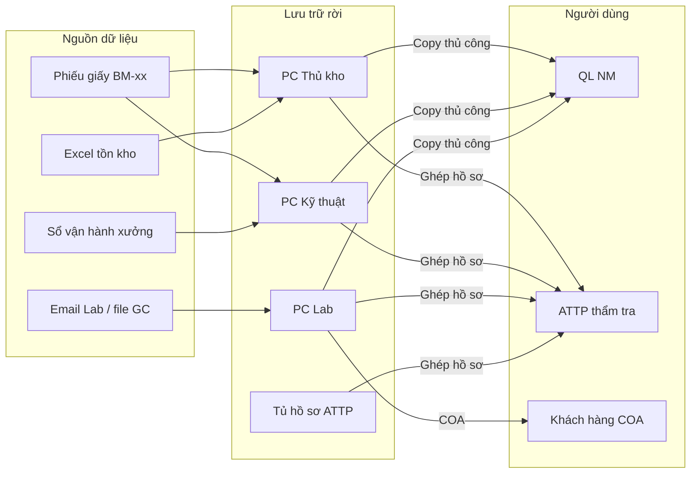
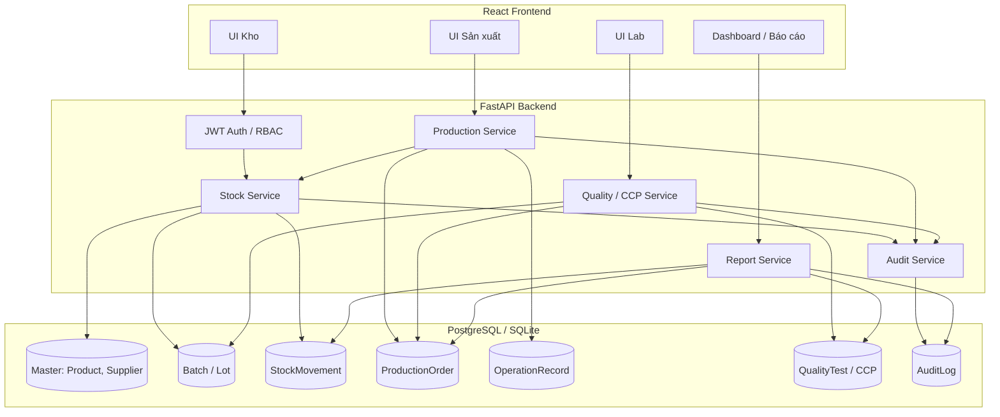
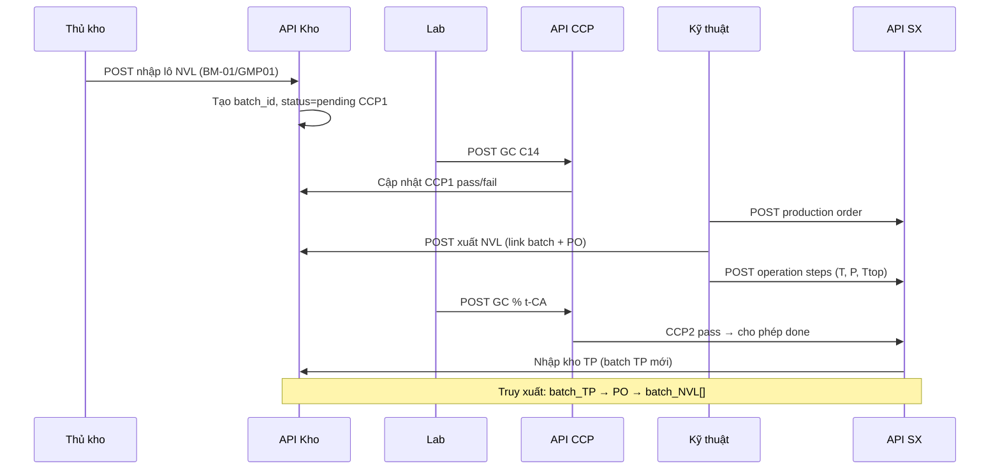
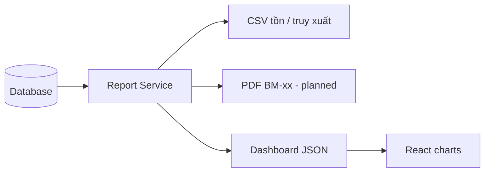

# Luồng dữ liệu (Data Flow)

> As-is vs To-be — mức logical data flow phục vụ Chương 4–5 báo cáo TTTN.

---

## 1. Luồng dữ liệu As-Is

**Vấn đề:** Không có master data tập trung; batch ID không thống nhất giữa file.

---

## 2. Luồng dữ liệu To-Be (hệ thống đề xuất)

---

## 3. Luồng batch traceability (chi tiết)

---

## 4. Bảng ánh xạ thực thể ↔ biểu mẫu

| Thực thể DB | Biểu mẫu | Module |
|-------------|----------|--------|
| StockMovement (in) | BM-01/GMP01 | Kho |
| Inventory snapshot | BM-02/GMP01 | Báo cáo |
| ProductionOrder + Step | BM-01/GMP03 | SX |
| ProductionMaterialUsage | BM-01/GMP04 | SX |
| MixingRecord (future) | BM-01/GMP05 | SX |
| QualityTest | BM-02/GMP05 | Lab |

Chi tiết ERD: `docs/database-design.md`

---

## 5. Luồng export / báo cáo

---

## 6. Dữ liệu nhạy cảm & bảo mật

- JWT token — không lưu plaintext password
- Audit log append-only
- Phân quyền theo role — segregation Thủ kho vs Lab vs ATTP
- Backup DB — `docs/backup-rollback.md`
