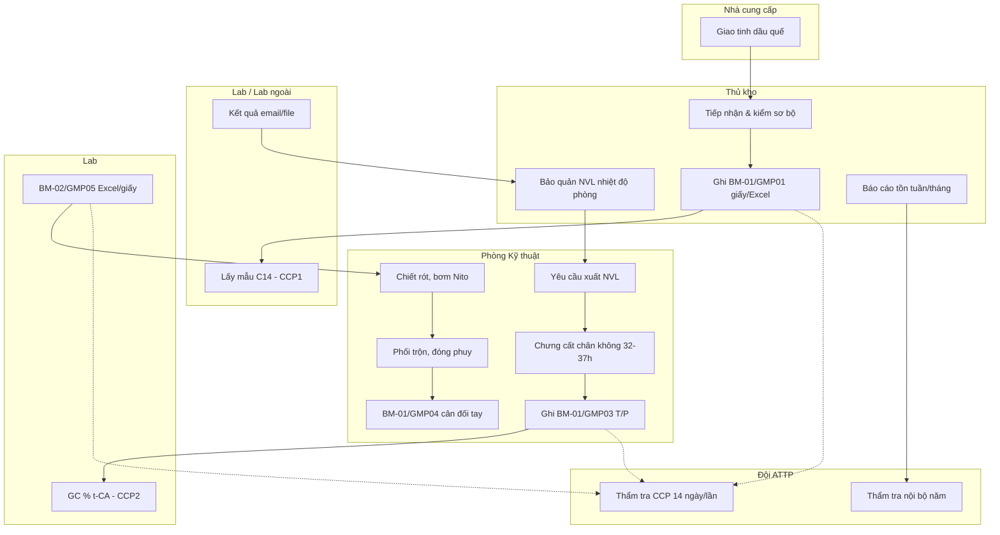

# Quy trình nghiệp vụ As-Is (hiện trạng)

> Tổng hợp từ tài liệu nội bộ Oxeyns — chưa số hóa tích hợp.

---

## 1. Tổng quan

Quy trình sản xuất **t-Cinnamic Aldehyde (t-CA)** từ tinh dầu quế, ~6 nhân sự, ghi chép chủ yếu **giấy + Excel rời** giữa Kho, Kỹ thuật, Lab và ATTP.

---

## 2. Sơ đồ quy trình as-is

---

## 3. Điểm nghẽn chính

| # | Điểm | Mô tả |
|---|------|--------|
| 1 | Dữ liệu phân tán | BM-xx lưu giấy + Excel nhiều PC |
| 2 | CCP thủ công | Không cảnh báo tự động C14/Ttop/% t-CA |
| 3 | Truy xuất lô | Ghép chứng từ thủ công khi khách/ATTP hỏi |
| 4 | Độ trễ Lab | Kho/SX không thấy trạng thái pending tập trung |
| 5 | Báo cáo QL NM | Hợp nhất tồn + tiến độ mẻ thủ công |

---

## 4. Công cụ hiện tại

- Excel / Google Sheets (tồn kho)
- Giấy BM-xx/GMPxx
- Email / Zalo trao đổi kết quả Lab
- Sổ tay ATTP, QT-xx (PDF/in giấy)

Chi tiết: `docs/hien-trang-cntt.md`

---

## 5. CCP trên quy trình as-is

| CCP | Vị trí | Giới hạn | Hồ sơ |
|-----|--------|----------|-------|
| CCP1 | Sau nhập NVL | C14 13.02–14.39 | BM-01/GMP01 |
| CCP2 | Chưng cất | Ttop 107–110°C; % t-CA > 99 | BM-01/GMP03, BM-02/GMP05 |

---

*As-is mô tả trước triển khai prototype — so sánh với `docs/process-to-be.md`.*
