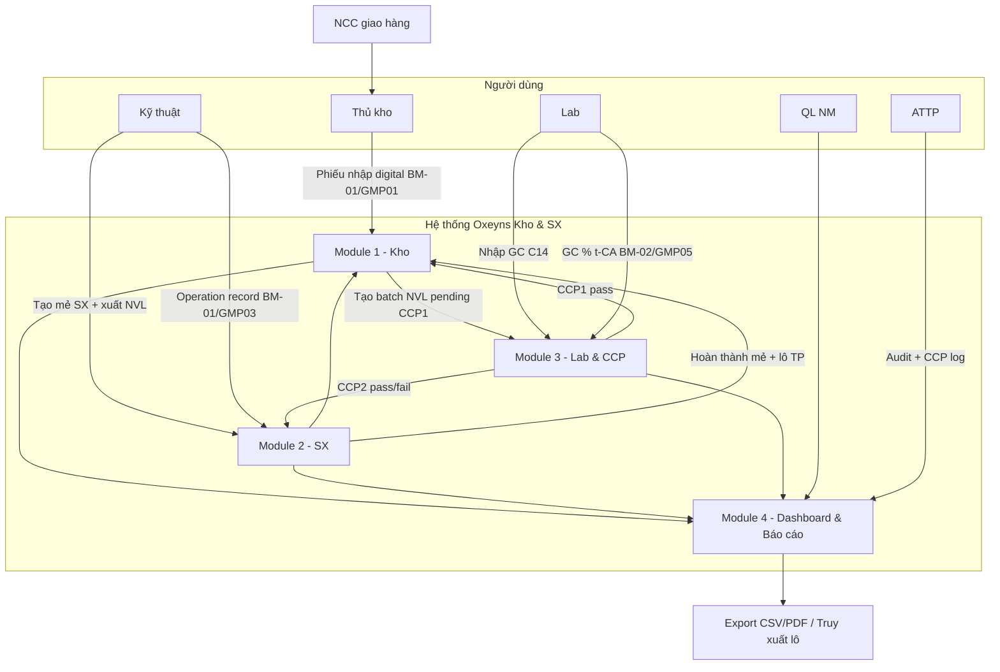
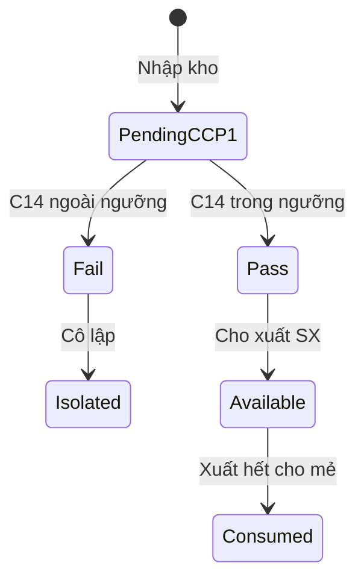
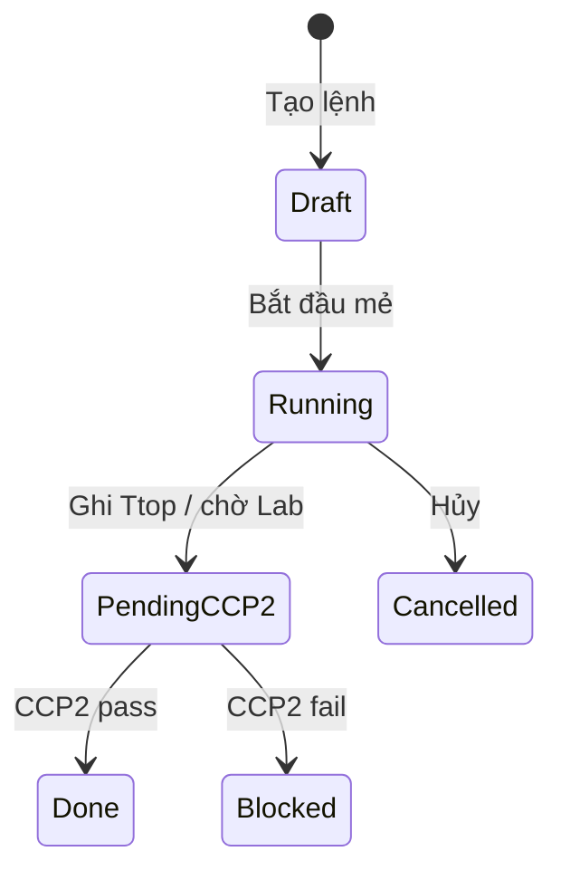

# Quy trình nghiệp vụ To-Be (đề xuất)

> Hệ thống web **Oxeyns Kho & SX** — FastAPI + React, một nguồn dữ liệu tập trung.

---

## 1. Nguyên tắc to-be

1. **Số hóa BM-xx** — giữ quy trình GMP/HACCP, không đột ngột bỏ bước nghiệp vụ
2. **Batch traceability** — mọi phiếu gắn mã lô
3. **Rule CCP tự động** — pass/fail/pending + chặn release
4. **Audit log** — phục vụ FSSC thẩm tra
5. Triển khai **theo module**: Kho → SX → Lab → Báo cáo

---

## 2. Sơ đồ quy trình to-be

---

## 3. Luồng trạng thái chính

### Lô NVL

### Mẻ sản xuất

---

## 4. Phân quyền to-be (RBAC)

| Role | Module chính |
|------|--------------|
| thu_kho | Nhập/xuất, tồn, YCMH |
| ky_thuat | Mẻ SX, operation record |
| lab | GC data, CCP |
| ql_nm | Dashboard, báo cáo |
| attp | CCP, audit, export |
| admin | Cấu hình, user |

---

## 5. Lộ trình triển khai

| Giai đoạn | Nội dung | Trạng thái demo |
|-----------|----------|-----------------|
| 1 | Kho + CCP1 + tồn | MVP ✅ |
| 2 | SX + operation + CCP2 | MVP ✅ |
| 3 | Lab GC + cảnh báo | MVP ✅ |
| 4 | Dashboard, truy xuất, audit | MVP ✅ |
| 5 | PDF BM-xx, mixing, duyệt lệnh | Mở rộng |

---

## 6. Lợi ích kỳ vọng

- Giảm thời gian lập báo cáo tồn/tuần
- Tra cứu truy xuất lô trong vài phút
- CCP fail được phát hiện sớm trên hệ thống
- Hồ sơ thẩm tra tập trung, có audit trail

---

*Chi tiết luồng dữ liệu: `docs/data-flow.md`*
